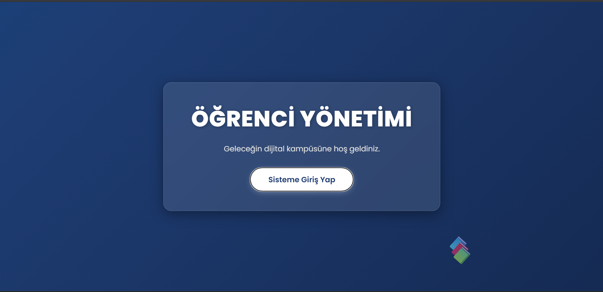
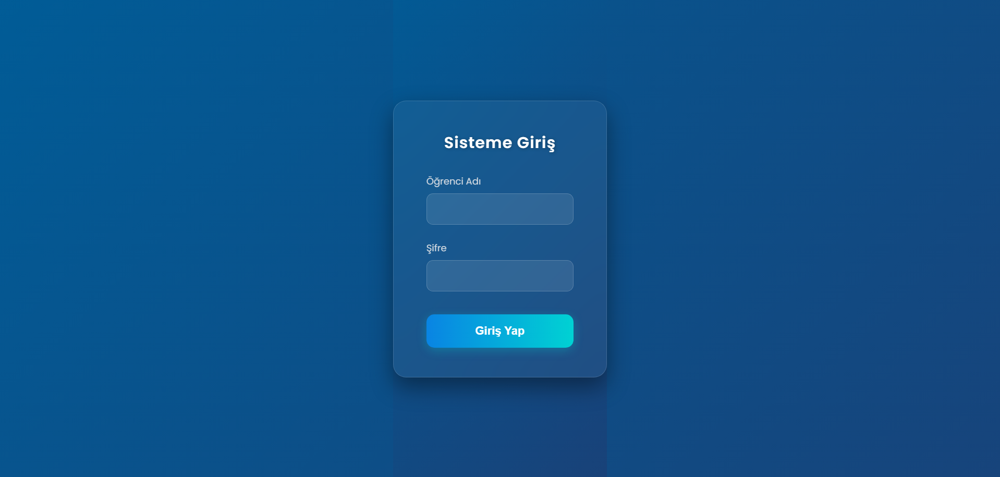
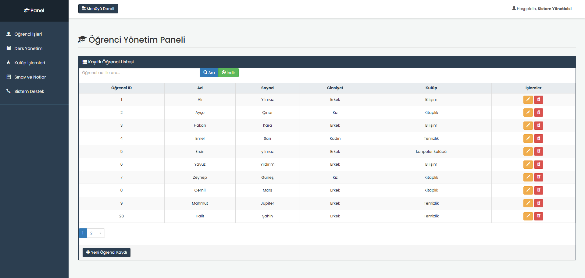
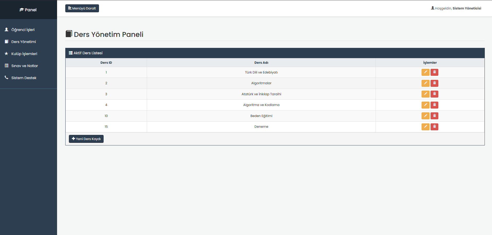
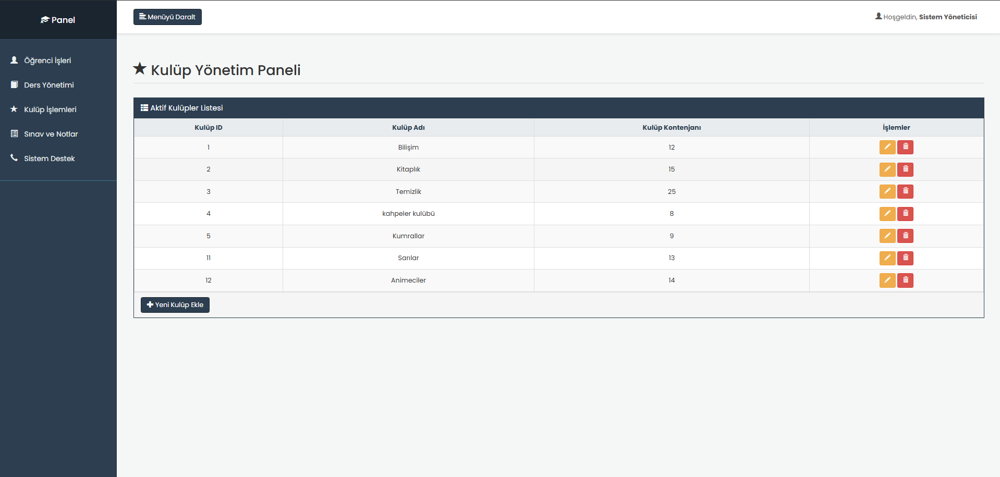
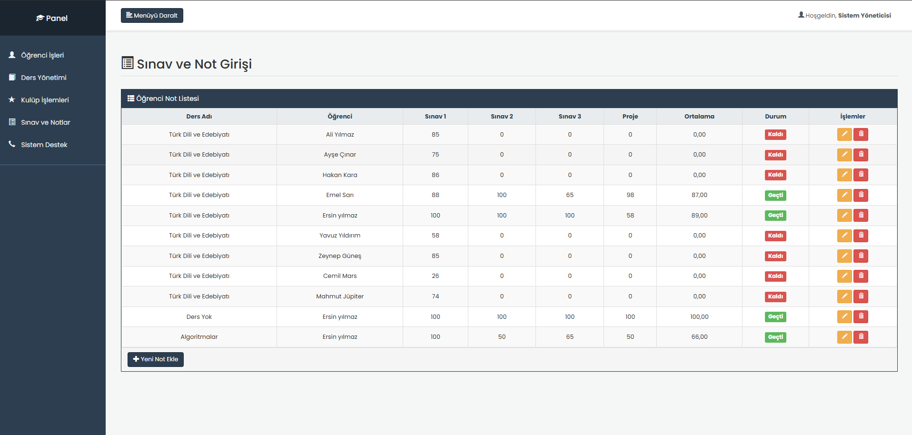
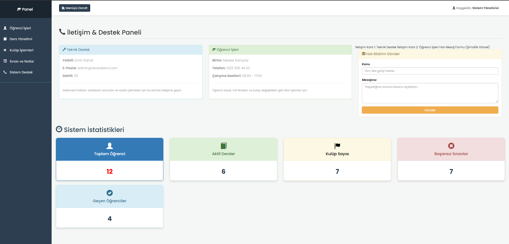

  <h1>🎓 Okul Yönetim ve Öğrenci Not Otomasyon Sistemi</h1>
  

    <strong>Modern, Güvenli ve Kapsamlı ASP.NET MVC Okul Yönetim Platformu</strong>
  

  

    <a href="#proje-hakkında">Proje Hakkında</a> •
    <a href="#teknolojiler">Teknolojiler</a> •
    <a href="#özellikler-ve-mimari">Özellikler & Mimari</a> •
    <a href="#ekran-görüntüleri">Görseller</a> •
    <a href="#geliştirici">Geliştirici</a>
  

 

## 📖 Proje Hakkında

**Okul Yönetim ve Öğrenci Not Otomasyon Sistemi**, eğitim kurumlarının dijital dünyadaki operasyon yükünü omuzlamak, veri akışını hızlandırmak ve öğrenci takip süreçlerini kusursuzlaştırarak tek bir merkezden yönetmek amacıyla sıfırdan geliştirilmiş profesyonel bir web uygulamasıdır. 

Proje; modern ve esnek bir yapı sunan **ASP.NET MVC 5** mimarisiyle harmanlanmış, arka planda **Entity Framework** ve **LINQ** gücünü arkasına alarak veritabanı işlemlerini en optimize şekilde gerçekleştirecek şekilde tasarlanmıştır.

---

## 🛠️ Kullanılan Teknolojiler ve Altyapı

* **Backend & Çatı:** C#, ASP.NET MVC 5, LINQ, Entity Framework (EF) ORM (Code-First / Database-First yaklaşımı)
* **Veritabanı & Sorgulama:** MS SQL Server, T-SQL (İlişkisel Veritabanı Tasarımı, Stored Procedure ve Join operasyonları)
* **Güvenlik & Oturum:** Forms Authentication, `[Authorize]` filtreleme mekanizmaları
* **Frontend & Arayüz:** HTML5, CSS3, JavaScript, Bootstrap 3/4, Glassmorphism & Modern UI/UX Prensipleri
* **Versiyon Kontrol:** Git, GitHub

---

## ⚙️ Başlıca Özellikler ve Mimari Detaylar

Projeyi standart bir okul ödevinin ötesine taşıyan, arkasındaki mühendislik ve mimari detaylar şunlardır:

1. **Katmanlı ve Modüler Yapı:** Proje; Controllers, Models ve Views olarak net bir şekilde ayrılarak sürdürülebilir, okunabilir ve "Clean Code" prensiplerine uygun bir yapıda kodlanmıştır.
2. **Güvenli Kimlik Doğrulama (Forms Authentication):** Yetkisiz kullanıcıların URL üzerinden doğrudan yönetim panellerine (Öğrenci, Ders, Not işlemleri) sızması `[Authorize]` öznitelikleriyle tamamen engellenmiştir. Sadece sisteme giriş yapan yetkililer içeriyi görebilir.
3. **İlişkisel Veritabanı ve LINQ Entegrasyonu:** Öğrenciler, dersler, kulüpler ve sınav notları birbiriyle sıkı bir şekilde ilişkilendirilmiştir. Listeleme ve filtreleme işlemlerinde LINQ sorgularından maksimum performansla yararlanılmıştır.
4. **Dinamik Not Hesaplama ve Başarı Algoritması:** Sınav 1, Sınav 2, Sınav 3 ve Proje notları girildiği anda sistem arka planda ortalamayı otomatik hesaplar; öğrencinin kalıp kalmadığını kontrol ederek arayüzde dinamik olarak **"Geçti"** veya **"Kaldı"** rozetlerini boyar.
5. **Gelişmiş Arama ve Raporlama Desteği:** Kullanıcılar aradıkları öğrenciye anında ulaşabilir, sistem istatistikleri paneli üzerinden okulun genel durumunu (toplam öğrenci, aktif dersler, başarılı/başarısız öğrenci sayıları) anlık olarak grafiksel kartlarda izleyebilir.

---

## 📸 Ekran Görüntüleri

Projenin arayüzünden ve modüllerinden örnek görseller:

| Karşılama Ekranı | Giriş Paneli |
| :---: | :---: |
|  |  |

| Öğrenci Yönetim Paneli | Ders Yönetim Paneli |
| :---: | :---: |
|  |  |

| Kulüp Yönetim Paneli | Sınav ve Not Girişi |
| :---: | :---: |
|  |  |

| Sistem İstatistikleri | |
| :---: | :---: |
|  | |

---

## 📚 Geliştirici Notu & Önerilen Okuma

Bu projeyi geliştirirken mimari kararları alırken ve kod kalitesini artırırken ilham aldığım, her yazılımcının kütüphanesinde bulunması gerektiğini düşündüğüm efsanevi bir kitap:

* 📖 **Clean Code: A Handbook of Agile Software Craftsmanship** – *Robert C. Martin* (Yazılımcılığın sadece çalışan kod yazmak olmadığını, okunabilir ve sürdürülebilir kodun önemini anlatan başucu eser.)

---

## 👨‍💻 Geliştirici

* **Emin Rahat** - [GitHub Profilim](https://github.com/eminrahat)

   
  
🌟 Bu projeyi beğendiyseniz yıldız vermeyi unutmayın!

